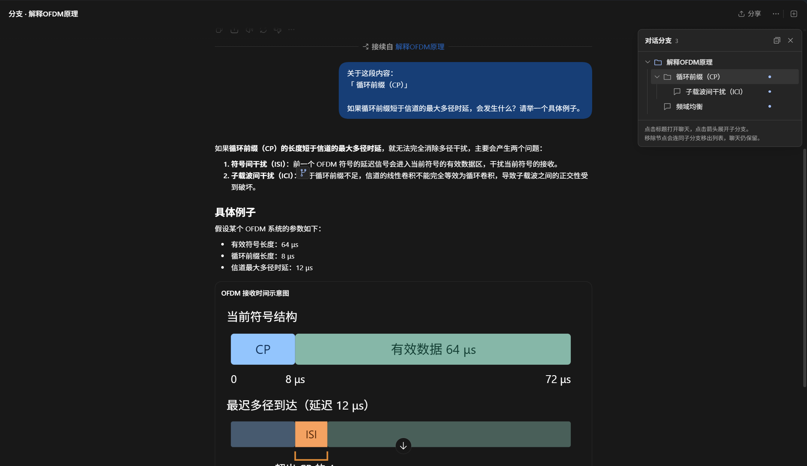
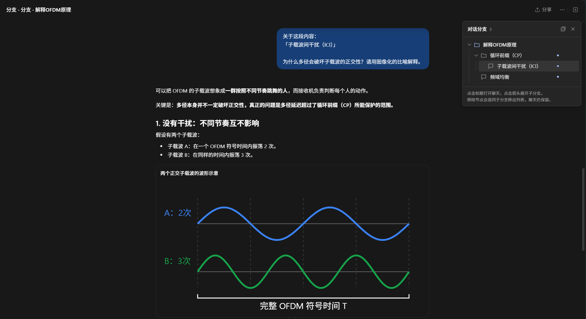

# ChatGPT Desktop Branch Companion

一个面向 Windows 版 ChatGPT / Codex 桌面客户端的实验性对话分支助手。

它在回答文字被选中时加入“添加到新的分支”，调用客户端已有的原生分叉能力，并在界面中提供接近 VS Code 资源管理器的分支树、原文标记与聊天跳转。

## 功能

- 在原生划词菜单旁加入“添加到新的分支”
- 保留分叉位置之前的上下文，并把选中文字预填到新分支输入框
- 在原文附近显示分支标记，点击后跳转到对应聊天
- 以树形列表展示来源聊天、分支和子分支
- 支持展开、折叠、键盘导航和当前聊天高亮
- 支持从列表移除节点及子分支，并可在 14 秒内撤销
- 分支元数据保存在本机的 `branch-state.json`

> 移除树节点不会删除 ChatGPT / Codex 中的聊天。

## 使用示例

下面以“解释 OFDM 原理”为主对话，依次展示划词创建分支、查看分支树和继续创建子分支。

### 1. 从回答中的选中文字创建分支

框选“正交子载波”后，原生划词菜单旁会出现“添加到新的分支”。已经创建过分支的位置会显示分支标记。


### 2. 在树形面板中查看全部分支

面板按照来源聊天、一级分支和子分支排列。点击标题可以打开对应聊天，点击箭头可以展开或折叠。


### 3. 打开一级分支继续追问

新聊天保留分叉位置之前的上下文，并在输入框中引用当时框选的“循环前缀（CP）”。右侧树会高亮当前节点。



### 4. 从分支中继续创建子分支

在一级分支的回答中继续框选“子载波间干扰（ICI）”，可以建立更深一层的分支，树形面板会保留父子关系。



## 运行要求

- Windows 10 或 Windows 11
- Microsoft Store / MSIX 安装的正式版 OpenAI 桌面客户端，包名为 `OpenAI.Codex`
- Node.js 22 或更新版本
- 系统自带的 Windows PowerShell 5.1

当前版本针对 2026 年 10 月的客户端界面验证。它依赖桌面客户端内部的 DOM 和 React 属性，客户端更新后可能需要同步适配。

## 使用方法

1. 下载仓库，或运行：

   ```powershell
   git clone https://github.com/Tetro02/chatgpt-desktop-branch-companion.git
   ```

2. 完全退出 ChatGPT / Codex 桌面客户端，包括后台进程。
3. 双击 `launch.cmd`。
4. 保持弹出的命令窗口开启。
5. 在回答中选中一段文字，点击“添加到新的分支”。
6. 在新分支输入框中继续追问。

启动器只连接到 `127.0.0.1:19347`。如果端口已被其他程序占用，启动器会停止并给出错误，不会连接到非本机地址。

## 数据与隐私

- `docs/images` 仅包含用户明确提供的公开功能示例，不包含账户信息、会话 ID 或本机路径。
- 仓库不包含其他测试聊天、调试截图或本机运行记录。
- 分支记录仅写入仓库目录下的 `branch-state.json`，该文件已被 Git 忽略。
- 记录包含被选中的文字、来源消息标识和目标聊天标识；分享或备份该文件前请自行检查内容。
- 程序不会把数据发送到额外的网络服务。它只使用本机 Chrome DevTools Protocol 端口控制已经登录的桌面客户端。

## 工作方式

`launch-branch-companion.ps1` 使用 `--remote-debugging-address=127.0.0.1` 启动正式版客户端。`inject.cjs` 通过本机 CDP 会话注入 `companion.js`，并负责持久化分支树。

本项目没有修改客户端安装文件。关闭启动器窗口或退出桌面客户端后，本次注入结束；再次使用需要重新运行 `launch.cmd`。

## 已知限制

- 只验证了正式版 `OpenAI.Codex`，Beta 版不在当前支持范围内。
- 不提供“随原启动入口自动运行”。此前的自动启动实验会影响正式版启动，因此未纳入公开代码。
- 客户端更新可能改变选择菜单、消息结构、分叉函数或路由接口。
- 当前界面为中文。
- 这是非官方项目，与 OpenAI 无隶属或认可关系。

## 开发与检查

项目没有第三方运行时依赖。修改后可运行：

```powershell
npm test
```

## 许可证

[MIT](LICENSE)
