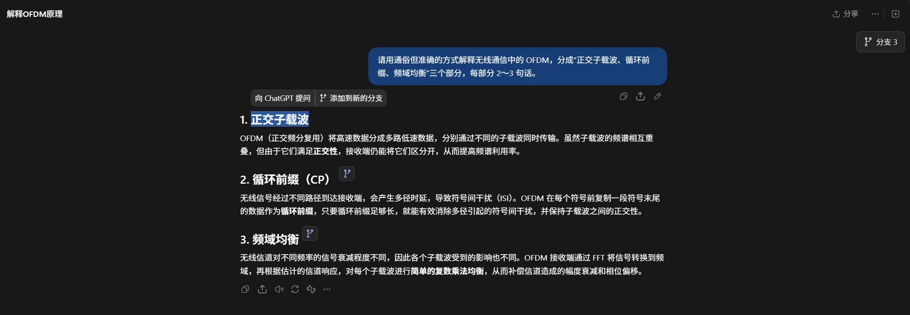
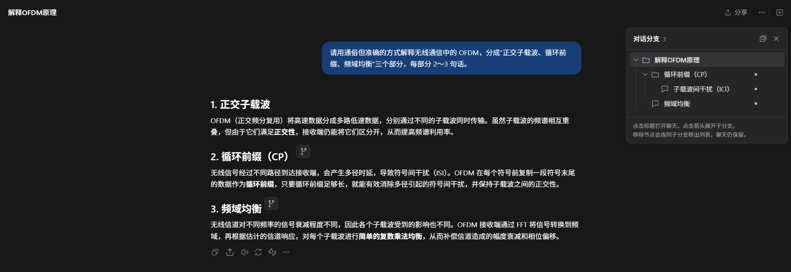

# 分支使用示例（0.3.3 历史界面）

以下截图沿用仓库已经公开的分支演示，用于说明工作方式；GPT助手 0.5.0 的面板名称和书签功能以当前说明为准。

## 使用示例

下面以“解释 OFDM 原理”为主对话，依次展示划词创建分支、查看分支树和继续创建子分支。

### 1. 从回答中的选中文字创建分支

框选“正交子载波”后，原生划词菜单旁会出现“添加到新的分支”。已经创建过分支的位置会显示分支标记。

### 2. 在树形面板中查看全部分支

面板按照来源聊天、一级分支和子分支排列。点击标题可以打开对应聊天，点击箭头可以展开或折叠。

### 3. 打开一级分支继续追问

新聊天保留分叉位置之前的上下文，并在输入框中引用当时框选的“循环前缀（CP）”。右侧树会高亮当前节点。

### 4. 从分支中继续创建子分支

在一级分支的回答中继续框选“子载波间干扰（ICI）”，可以建立更深一层的分支，树形面板会保留父子关系。

